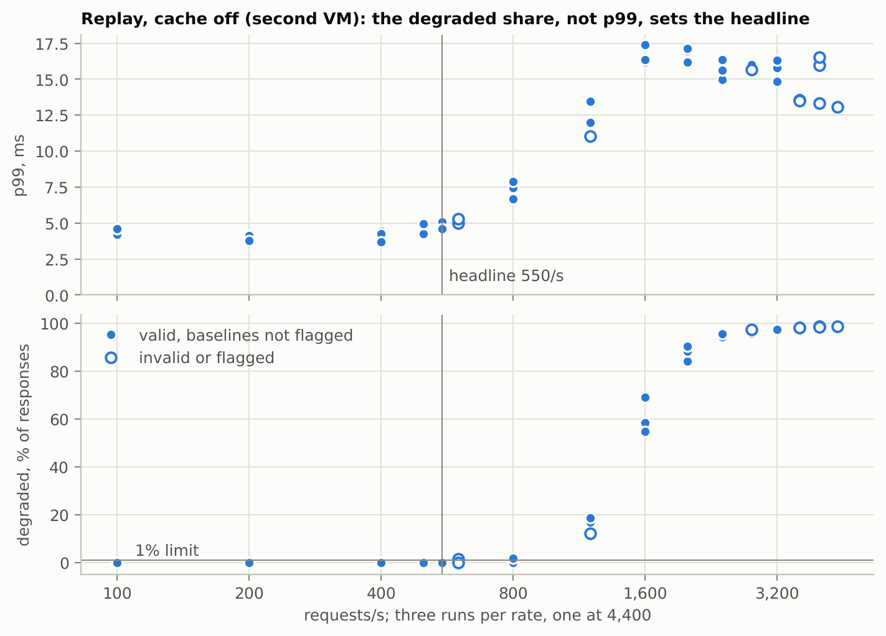
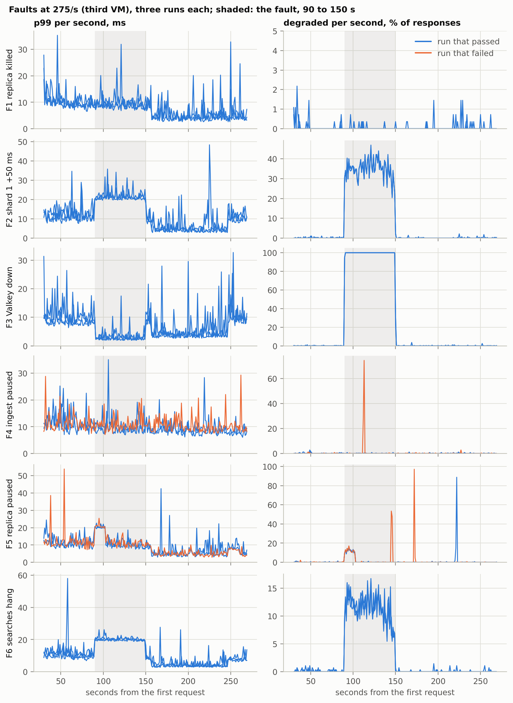
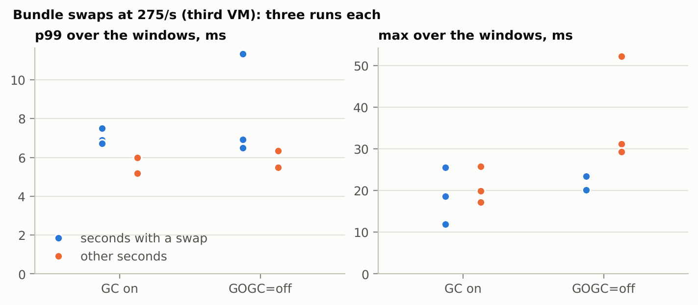
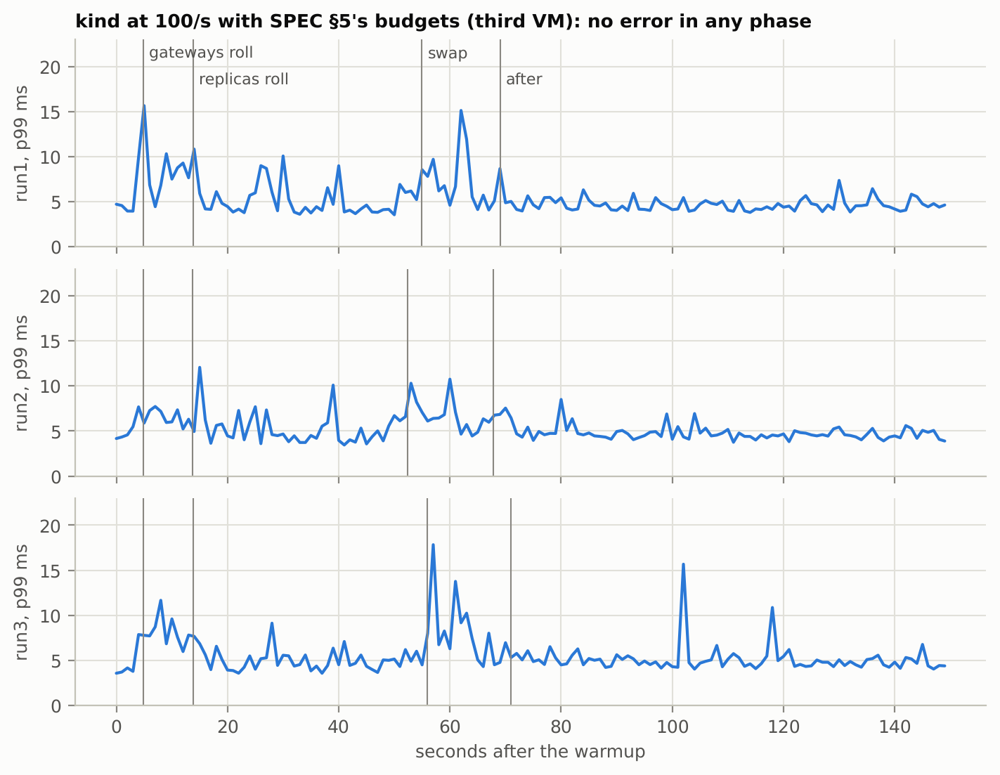
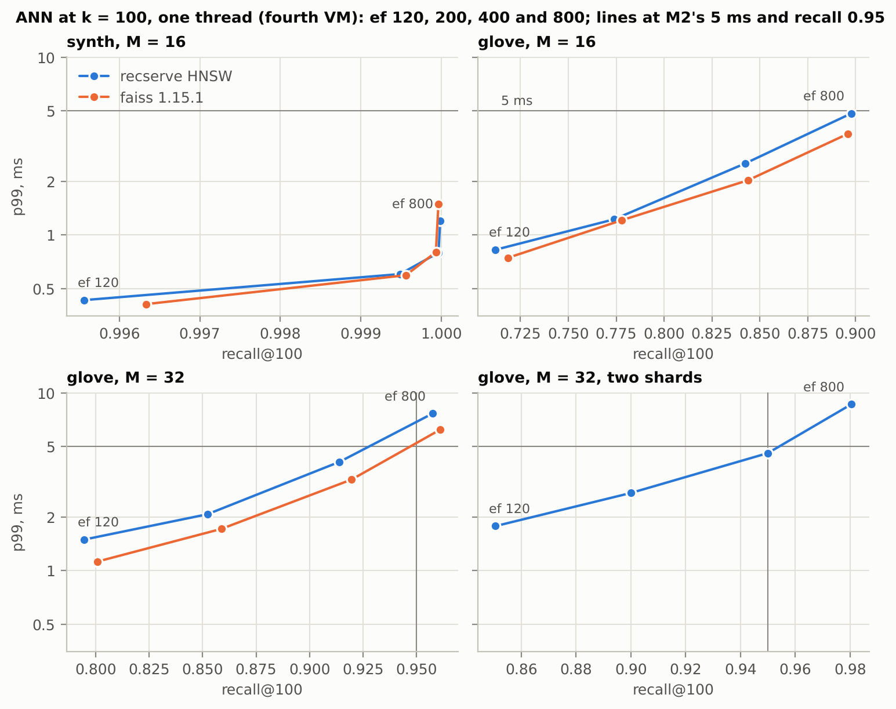

# M6 benchmark report

M6's results with charts: load, profiles, faults, hedge delay, swaps, kind and ANN. The headline is **550 requests/s** on a 4-vCPU cloud VM with every service on three of its CPUs (replay, cache off, p99 4.59 to 5.07 ms). M7 reran the faults with the cache off, amended criteria, a breaker that opens on a failure rate (D037) and outlier detection (D041); its results in [BENCHMARKS.md](../../docs/BENCHMARKS.md) (M7, second set) supersede the fault results here, which describe the service with the cache on. Figures come from the result files here, and `make report` redraws the charts; protocols and tables are in BENCHMARKS.md (M6) and [BENCHMARK_PROTOCOL.md](../../docs/BENCHMARK_PROTOCOL.md).

## Load

<picture>
  <source media="(prefers-color-scheme: dark)" srcset="figures/sweep-dark.png">
  
</picture>

Replay, cache off, three runs per rate, on the second VM. The headline is the highest rate at which all three runs are valid and unflagged, with p99 ≤ 50 ms and at most 1% degraded (D005 as amended by D054). Above 800/s p99 stays under 18 ms because degraded responses are cheap (a request whose history read runs past its budget skips vector retrieval), while the degraded share climbs to 98 to 99% from 3,600/s.

- A gateway on 2 CPUs is estimated at **1,821 requests/s** from its CPU per request at the headline, 1.098 ms. The admission limits follow from it: `-max-rate` 1,450 and `-max-inflight` 152 (D050).
- The other five scenarios: the cache hits 47 to 80% of lookups, and SPEC §5's history budget became 5 ms (D039); the headline ran with 3 ms.

## Profiles and two optimizations

`vec.Dot`, exact search's float64 inner product, had 54% of a replica's CPU at 400 requests/s on the first VM. In AVX2 (D053) it takes 4.2 to 5.4 times less time, the replicas use about 37% less CPU per request, and p99 falls by 15 to 26% at 200/s and 33 to 45% at 400/s; the gateway's CPU per request is not resolved at 400/s. `vec.Dot32`, the HNSW index's float32 product, had 76% of annbench's CPU on glove on the fourth VM; in AVX (D055) it takes 2.7 to 3.3 times less time and annbench's p99 on glove is 0.50 to 0.61 times the p99 before at every ef, with the same recall@100. In the service it runs only in MMR, with no difference resolved in the gateway's CPU per request.

## Faults (superseded by M7)

<picture>
  <source media="(prefers-color-scheme: dark)" srcset="figures/faults-dark.png">
  
</picture>

At 275 requests/s on the third VM, cache on, three valid runs each, judged by criteria committed beforehand. No valid run has an error, and every fault phase keeps p99 ≤ 50 ms.

- F1 replica killed: pass as written, fault phase p99 8.7 to 10.1 ms, 0.0% degraded.
- F2 50 ms on shard 1's replicas: pass as written, 21.1 to 21.2 ms, 34.5 to 35.0% degraded, all `shards_partial`.
- F3 Valkey unavailable: pass, 2.6 to 3.1 ms, 99.9% `history_unavailable`.
- F4 ingest's consumer paused: fail, 9.1 to 10.6 ms, 0.0 to 1.7% degraded.
- F5 replica paused: fail, 18.8 to 19.1 ms, 2.6 to 4.4% degraded.
- F6 searches hang, pings answered: pass as written, 19.6 to 20.5 ms, 11.2 to 11.5% `shards_partial`.

- **F4 and F5 fail on one second of one run** in which the breaker on Valkey was open: `history_unavailable` rose 1.67 points above the healthy phase in F4's run 3 and 2.22 points in F5's run 3, past the 1-point limit. Every second outside F3's fault with more than 20% `history_unavailable` starts with the breaker opening in the gateway's log. The breaker then opened after five failed Valkey calls in a row (D037); M7 attributed two openings in runs with no fault to calls that ran out of their budget, and why those ran past it is not established.
- **Two criteria could not show what they state**, which M7 amended ([BENCHMARK_ERRATA.md](../../docs/BENCHMARK_ERRATA.md)). That a restarted replica serves searches again (F1, F5) was judged by its CPU being above zero in the last 60 s, which a replica without searches may also use (4 to 28 ms in F1, where every replica was nearly idle). And the cache answers 86 to 99% of the lookups in the recovery phases, so shard 0 gets 2 to 25 calls per second there against 73 to 79 while healthy: the recovery criterion of F1, F2, F5 and F6 had no power at this load.
- F5 holds 11.8 to 12.1% of the responses partial in the 13 s before the keepalive takes the paused replica out, and F6 11.2 to 11.5% while the searches hang, so outlier detection was adopted (D041) and built in M7. These runs used the hedge delay of the time, 5 ms.

## Hedge delay: 2.5 ms

With hedging off, a call to a replica has a p95 of 1.91 to 2.20 ms, and the default becomes the median of the larger shard's, rounded up to 0.5 ms. With it, 1.0 to 1.3% of the searches send a hedge, fewer than the 5% the rule aims at, because of the rounding. A difference in p99 is not resolved.

## Bundle swaps

<picture>
  <source media="(prefers-color-scheme: dark)" srcset="figures/swaps-dark.png">
  
</picture>

Nine swaps per run at 275 requests/s on the third VM. The seconds with a swap have a higher p99 in every run, with GC on or off. Their maximum is lower in every run with GC off; with GC on it is higher in one run and lower in two. A swap's prepare took 65 to 864 ms. No cause is named: the rule reads the ratio of maxima with `GOGC=off` as GC, which assumes the swap seconds hold the largest values with GC on, and these runs do not establish that.

## Rollouts and a swap in kind with SPEC §5's budgets

<picture>
  <source media="(prefers-color-scheme: dark)" srcset="figures/kind-dark.png">
  
</picture>

At 100 requests/s on the third VM, three new clusters: no error in any phase, at most 0.133% of a phase degraded, and p99 at most 9.91 ms, during the gateways' rollout. Not judged: the control plane shares the CPUs.

## ANN on glove and synthetic vectors

<picture>
  <source media="(prefers-color-scheme: dark)" srcset="figures/ann-dark.png">
  
</picture>

At k = 100, one thread, on the fourth VM, after `vec.Dot32`'s change; at the same ef, recserve's p99 is 0.80 to 1.05 times faiss's on synth and 1.01 to 1.33 times on glove, with recall within 0.007. By M2's criterion, recall@100 ≥ 0.95 at a p99 ≤ 5 ms, synth passes at ef 120 (0.9956, 0.43 ms) and glove fails on latency, as in M2: it reaches 0.95 only with M = 32 at ef 800, at 7.66 ms, where faiss takes 6.21 ms. Two shards on these 4 vCPUs reach 0.94997 at ef 400, just under 0.95, and qualify at ef 800, at 8.63 ms.

## Limits

- M6 ran on four cloud VMs of the same kind (4 vCPU, shared hosts) whose speeds differ, so figures from different VMs are not compared. Every service ran on the same three CPUs, with the load generator on the fourth: the headline and the capacity are this machine's and this topology's, and the capacity is an estimate.
- Not measured: the sharded tier through annshard on glove, the cost of tracing (compose samples every request; a production deployment would sample about 1%, D051) and the slow path of `vec.Dot32`'s Go code on CPUs without AVX2.
