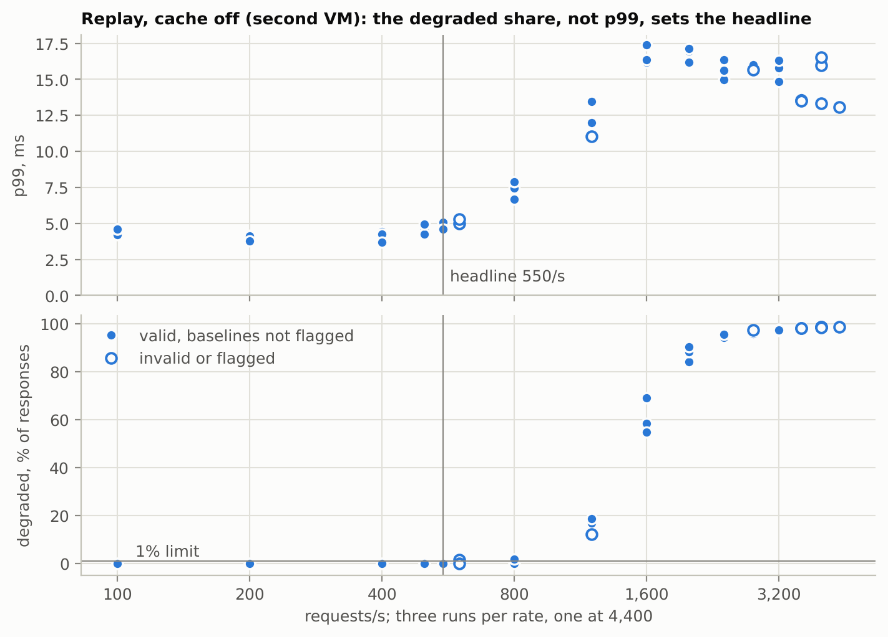
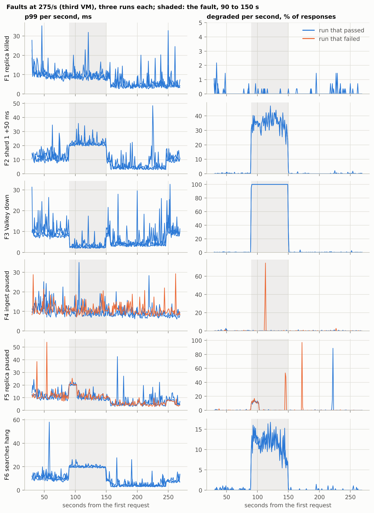
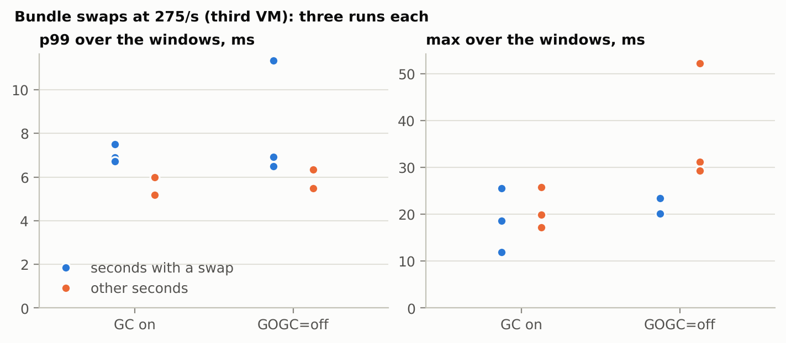
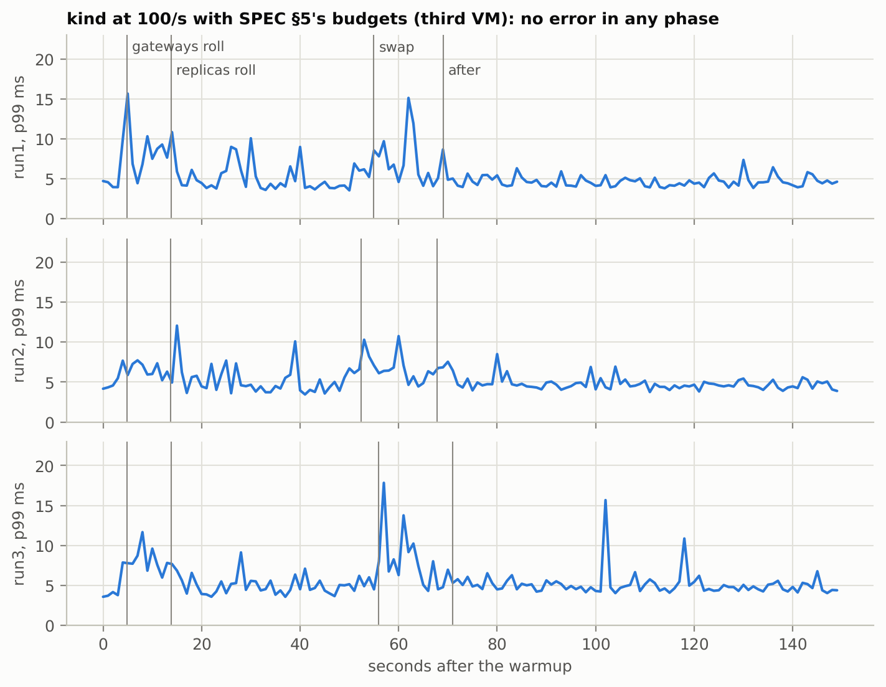
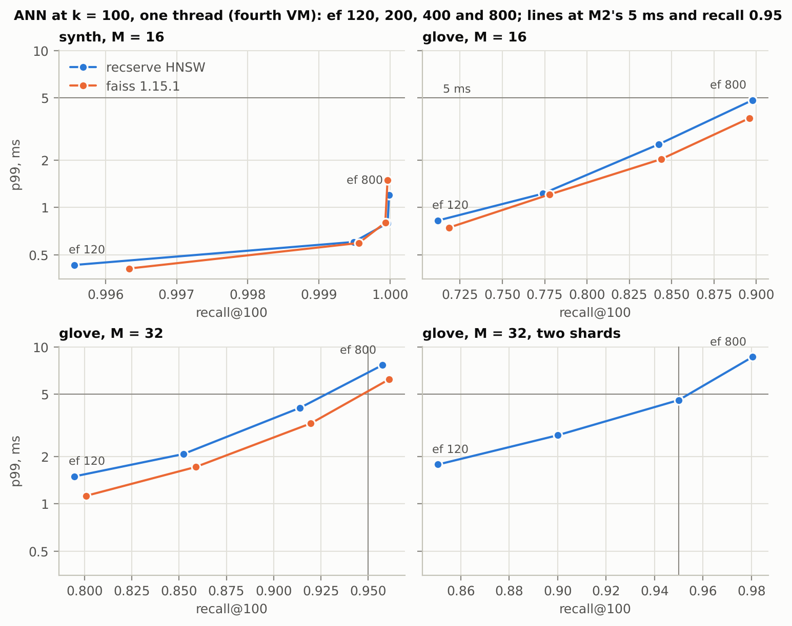

# M6 benchmark report

What M6 measured, with charts. The protocols, pass criteria and full tables are in [docs/BENCHMARKS.md](../../docs/BENCHMARKS.md) (Results, M6); every figure here comes from the result files in this directory, and `make report` redraws the charts from them.

**Read first.**

- M6 ran on four cloud VMs of the same kind (4 vCPU, shared hosts): the profiles and `vec.Dot`'s optimization on the first, the load sweeps and the runs that follow from them on the second, the fault, hedge, swap and kind runs on the third, the ANN runs and `vec.Dot32`'s comparison on the fourth. Their speeds differ (at 275 requests/s with the cache off, p99 was near 6 ms on the third and 3.9 to 4.1 ms on the second), so figures from different VMs are not compared with one another.
- Every service ran on the same three CPUs, with the load generator on the fourth. The headline and capacity are this machine's and this topology's figures; a gateway's capacity is an estimate.
- The headline sweep ran with the history budget at its old value, 3 ms. From the fault runs on, every run uses 5 ms, the value the sweeps led to (D039).

## Load: headline 550 requests/s

<picture>
  <source media="(prefers-color-scheme: dark)" srcset="figures/sweep-dark.png">
  
</picture>

Replay with the cache off, three runs per rate, on the second VM. The headline is the highest rate at which all three runs are valid and unflagged, with p99 ≤ 50 ms and at most 1% of the responses degraded (D005 as amended by D054): **550 requests/s**, p99 4.59 to 5.07 ms. Above 800/s p99 stays low because degraded responses are cheap: a request whose history read runs past its budget skips vector retrieval.

- A gateway on 2 CPUs is estimated at **1,821 requests/s** from its CPU per request at the headline, 1.098 ms, measured while it shared its CPUs with the rest of the service. The admission limits follow from it: `-max-rate` 1,450 and `-max-inflight` 152 (D050).
- From the other five scenarios: the cache hits 47 to 80% of lookups, and SPEC §5's history budget became 5 ms (D039).

## Profiles and two optimizations

`vec.Dot`, the float64 inner product of exact search, had 54% of a replica's CPU at 400 requests/s on the first VM. In AVX2 (D053) it takes 4.5 to 5 times less time; the replicas use about 37% less CPU per request, and p99 falls by about a quarter at 200/s and a third at 400/s. The gateway's CPU per request at 400/s is not resolved.

`vec.Dot32`, the float32 inner product of the HNSW index, had 76% of annbench's CPU on glove on the fourth VM. In AVX (D055) it takes 2.7 to 3.3 times less time, and annbench's p99 on glove after is 0.50 to 0.61 times the p99 before at every ef, with the same recall@100. In the service it runs only in MMR, and the gateway's CPU per request is not resolved.

## Faults: F1, F2, F3 and F6 pass; F4 and F5 fail

<picture>
  <source media="(prefers-color-scheme: dark)" srcset="figures/faults-dark.png">
  
</picture>

At 275 requests/s on the third VM, cache on, three valid runs per fault, each judged by criteria committed before any fault ran. No valid run has an error, and every fault phase keeps p99 ≤ 50 ms.

| Fault | Result | Fault phase p99, ms | Degraded in the fault phase |
|---|---|---|---|
| F1 replica killed | pass | 8.7 to 10.1 | 0.0% |
| F2 50 ms on shard 1's replicas | pass | 21.1 to 21.2 | 34.5 to 35.0%, all `shards_partial` |
| F3 Valkey unavailable | pass | 2.6 to 3.1 | 99.9%, `history_unavailable` |
| F4 ingest's consumer paused | fail | 9.1 to 10.6 | 0.0 to 1.7% |
| F5 replica paused | fail | 18.8 to 19.1 | 2.6 to 4.4% |
| F6 searches hang, pings answered | pass | 19.6 to 20.5 | 11.2 to 11.5% `shards_partial` |

- **Why F4 and F5 fail.** Each fails on one second of one run in which the gateway's circuit breaker on Valkey was open: `history_unavailable` rose 1.67 points above the healthy phase in F4's run 3 and 2.22 points in F5's run 3 (from 15 s after the pause on), past the 1-point limit. The breaker opens after five failed Valkey calls in a row and tries again a second later (D037); what made those five calls fail is not established.
- **Degraded responses in whole seconds** come from the breaker being open for a second: in the fault runs, every second outside F3's fault with more than 20% `history_unavailable` starts with the breaker opening in the gateway's log. The sweep at 1,200/s shows the same pattern, with no log taken to confirm it. What triggers the openings is not established, and the gateway exports no metric of the breaker's state.
- **Recovery times rest on little search traffic.** The cache answers 86 to 99% of the lookups in the recovery phases, so shard 0 gets 2 to 25 calls per second there, against 73 to 79 while healthy. The recovery times of the replica faults (0 s for F1, F2, F5 and F6) are measured on that much traffic.
- F5 and F6 hold 11 to 12% of the responses partial while the replica is silent; by the rule committed beforehand, outlier detection on the replicas is adopted (D041) and left to M7.

## Hedge delay: 2.5 ms

With hedging off, a call to a replica has a p95 of 1.91 to 2.20 ms; the default becomes the median of the larger shard's, rounded up to 0.5 ms. With it, 1.0 to 1.3% of the searches send a hedge, fewer than the 5% the rule aims at, because of the rounding up. A difference in p99 is not resolved (third VM).

## Bundle swaps

<picture>
  <source media="(prefers-color-scheme: dark)" srcset="figures/swaps-dark.png">
  
</picture>

Nine swaps per run at 275 requests/s on the third VM. The seconds with a swap have a higher p99 than the others in every run, with GC on or off, and no higher maximum. A swap's prepare took 65 to 864 ms. No cause is named: the rule committed beforehand reads the ratio of maxima with `GOGC=off` as GC, but it takes for granted that the swap seconds hold the largest values with GC on, and here they do not, so there is nothing for GC to explain (a dated defect of the rule, in BENCHMARKS).

## Rollouts and a swap in kind with SPEC §5's budgets

<picture>
  <source media="(prefers-color-scheme: dark)" srcset="figures/kind-dark.png">
  
</picture>

At 100 requests/s on the third VM, each run on a new cluster: no error in any phase, at most 0.133% of a phase degraded, and p99 at most 9.91 ms, during the gateways' rollout. Reported, not judged: the control plane shares the CPUs (D022).

## ANN on glove and synthetic vectors

<picture>
  <source media="(prefers-color-scheme: dark)" srcset="figures/ann-dark.png">
  
</picture>

At k = 100, one thread, on the fourth VM after `vec.Dot32`'s change; graphs built with 4 goroutines, faiss 1.15.1 on the same sets. At the same ef, recserve's p99 is 0.80 to 1.05 times faiss's on synth and 1.01 to 1.33 times on glove, with recall within 0.007.

- By M2's criterion, recall@100 ≥ 0.95 at a p99 ≤ 5 ms, synth passes at ef 120 (0.9956, 0.43 ms) and glove fails on latency, as in M2: it reaches 0.95 only with M = 32 at ef 800, at 7.66 ms, where faiss takes 6.21 ms.
- Two shards on these 4 vCPUs reach 0.94997 at ef 400 (4.58 ms), just under 0.95; their first qualifying ef is 800, at 8.63 ms.

## Not measured

- The sharded tier through annshard on glove; the service's calls through annshard are measured on the real bundle by the hedge runs (D052).
- The cost of tracing; compose samples every request, a production deployment about 1% (D051).
- The trigger of the breaker's openings, and the slow path of `vec.Dot32`'s Go code on CPUs without AVX2.
